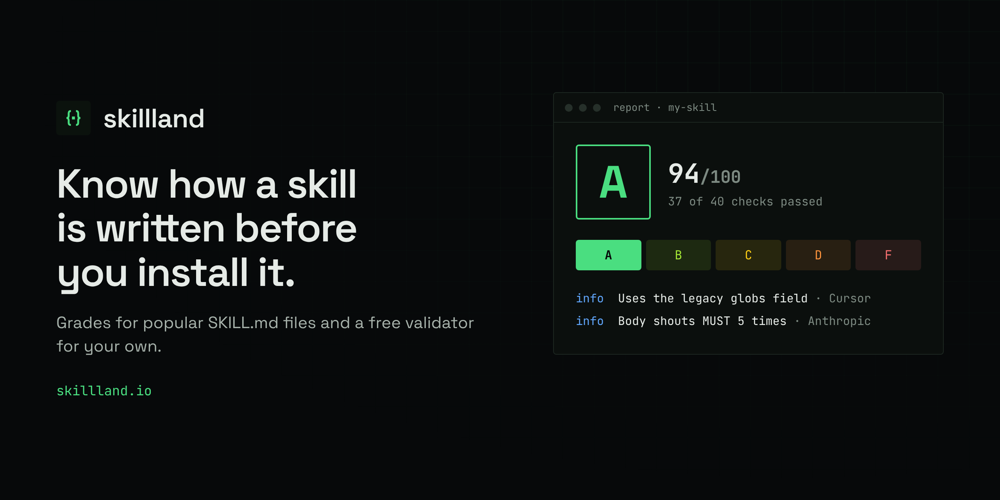

<p align="center">
  <a href="https://skillland.io"></a>
</p>

Skillland is a directory of the most installed agent skills for Claude Code, Codex and Cursor. Every skill gets a score from 0 to 100 and a grade from A to F, based on how its SKILL.md is written.

The score comes from public rules. Each rule quotes the official source it is based on (the Agent Skills spec, Anthropic, OpenAI, Cursor), and the formula is on [How scores work](https://skillland.io/methodology). A score says how a skill is written, not whether it is safe to run. Read a skill before you install it.

### Repositories

| Repo | What it is |
| --- | --- |
| [skill-validator](https://github.com/skillland-io/skill-validator) | The rules and scoring, published as [`@skillland/validator`](https://www.npmjs.com/package/@skillland/validator). MIT. |

### Check a skill

```bash
npx @skillland/validator check ./my-skill
```

Or paste a SKILL.md at [skillland.io/validate](https://skillland.io/validate).

Found a rule that reads the spec wrong? [Open an issue](https://github.com/skillland-io/skill-validator/issues) with a link to the source.
